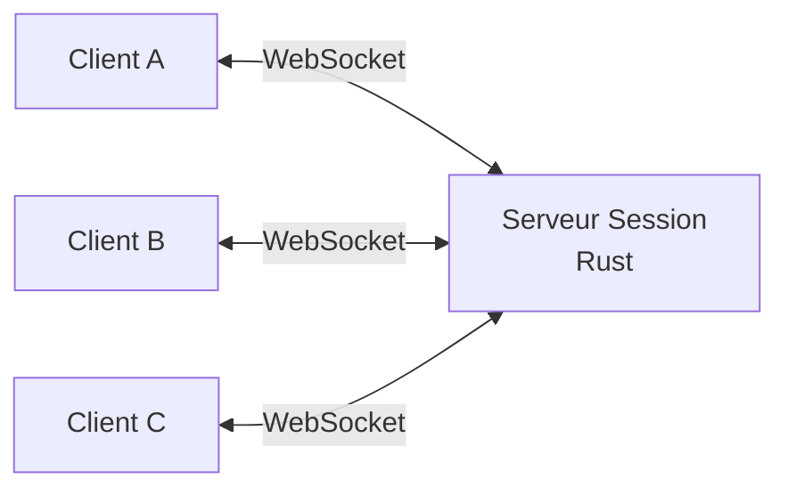

## Qu'est-ce qu'OpenWatchParty ?

**OpenWatchParty** est un plugin Jellyfin qui permet la lecture synchronisée de médias sur plusieurs clients. Regardez des films et des séries avec vos amis, où qu’ils se trouvent.

Contrairement au SyncPlay intégré de Jellyfin, OpenWatchParty utilise un serveur de session externe dédié, offrant une synchronisation plus fiable et une meilleure gestion de la latence.

## Architecture

Le système comprend trois composants :

| Composant | Technologie | Rôle |
|-----------|-------------|------|
| **Plugin Jellyfin** | C# | Fournit le JavaScript client et l’interface de configuration |
| **Serveur de session** | Rust | Gère les salons et relaie les messages par WebSocket |
| **Client Web** | JavaScript | Intégré à l’interface de Jellyfin, coordonne la lecture |



## Fonctionnalités

- **Synchronisation en temps réel** : la lecture reste synchronisée entre tous les participants
- **Gestion par salons** : créez et rejoignez des salons de visionnage
- **Contrôle par l’hôte** : le créateur contrôle la lecture (lancement, pause, déplacement)
- **Suivi de la latence** : mesure et affichage du temps aller-retour (RTT)
- **Correction de dérive** : ajustement automatique de la vitesse pour maintenir la synchronisation
- **Prise en charge de HLS** : fonctionne avec les contenus transcodés via HTTP Live Streaming
- **Authentification JWT** : vérification de l’identité des utilisateurs

## Installation

### 1. Déployer le serveur de session

```bash
docker run -d \
  -p 3000:3000 \
  -e ALLOWED_ORIGINS=https://votre-domaine-jellyfin.com \
  ghcr.io/mhbxyz/openwatchparty-session-server:latest
```

### 2. Ajouter le dépôt de plugins

Dans le tableau de bord de Jellyfin :

1. Aller dans **Dashboard** > **Plugins** > **Repositories**
2. Ajouter l'URL du dépôt OpenWatchParty
3. Installer le plugin depuis le Catalogue

### 3. Activer le script client

Dans le tableau de bord de Jellyfin :

1. Aller dans **Dashboard** > **Général**
2. Ajouter le script HTML personnalisé pour activer le client

## Comment ça fonctionne

1. **Synchronisation des horloges** : les clients estiment leur décalage avec le serveur au moyen d’une moyenne mobile exponentielle (EMA)
2. **Création d’un salon** : l’hôte crée un salon et partage son code
3. **Arrivée des participants** : les autres rejoignent le salon avec son code
4. **Événements de lecture** : quand l’hôte lance la lecture, met en pause ou change de position, l’action est diffusée à tous
5. **Détection de dérive** : si un client se désynchronise, sa vitesse de lecture est ajustée pour rattraper le retard

## Développement

```bash
# Cloner le dépôt
git clone https://github.com/mhbxyz/OpenWatchParty.git
cd OpenWatchParty

# Démarrer l'environnement de dev
make up

# Lancer en mode dev
make dev

# Surveiller les changements
make watch
```

## Ressources

- **Documentation** : https://mhbxyz.github.io/OpenWatchParty/
- **GitHub** : https://github.com/mhbxyz/OpenWatchParty
- **Licence** : MIT
